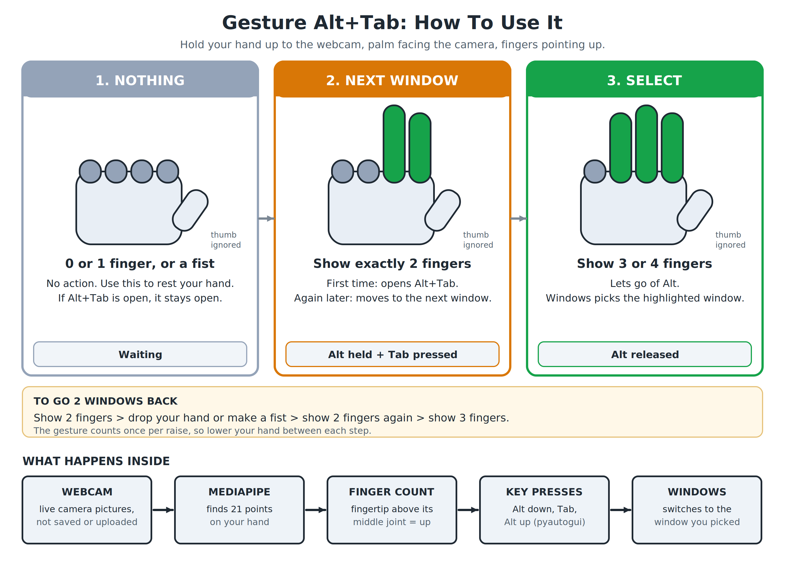

# Gesture Alt+Tab (Software-Only Edition)

Switch windows on your Windows PC with your hand. No hardware, no wires, no soldering. Your webcam watches for simple finger gestures and presses Alt+Tab for you.

Looking for the version with a physical ESP32 button? See the `main` branch of this repository.



## What it does

| You show the camera | Your PC does |
|---|---|
| 2 fingers | Opens Alt+Tab. Show 2 fingers again later to move to the next window |
| 3 or 4 fingers | Lets go of Alt. Windows switches to the window that was highlighted |
| 0 or 1 finger, or a fist | Nothing |

Hold your hand up with the palm facing the camera and the fingers pointing up. The thumb is not counted.

## What you need

- A Windows 10 or 11 PC with a webcam
- Option B only: Python 3.11 or newer

## Option A. Easiest: use the ready-made app (no Python)

1. On the right side of this page click **Releases**, then the newest release.
2. Under **Assets** click `PrivacyGesture.exe` to download it.
3. Double-click the file. The first start can take a few seconds.
   - Windows may say **Windows protected your PC** because the app is not digitally signed. Click **More info**, then **Run anyway**. If you would rather not run an unsigned app, use Option B and read the code yourself.
4. Look for a blue circle with a **G** next to the clock. If you do not see it, click the small **^** arrow to show hidden icons.
5. Click the icon (or right-click it and pick **Enable gestures**). A camera window called **Privacy Gesture** opens.
6. Show your hand to the camera and try the gestures above.
7. To stop: right-click the icon and pick **Disable gestures**. To close the app: **Exit**.

## Option B. Run it from the code

1. Install Python from [python.org/downloads](https://www.python.org/downloads/). In the installer tick **Add python.exe to PATH**, then click **Install Now**.
2. On this page click the green **Code** button, then **Download ZIP**. Unzip it.
3. Open the unzipped folder in File Explorer. Click the address bar, type `cmd`, press Enter.
4. In the black window type this and press Enter (it downloads the libraries, a few minutes):

```
pip install -r requirements.txt
```

5. Start the app:

```
python gesture_worker.py
```

6. The blue **G** icon appears next to the clock. Click it to enable gestures, same as Option A.

The author tested this with Python 3.14 on Windows. If `pip` says it cannot find an exact version, run this instead:

```
pip install mediapipe opencv-python pyautogui pystray pillow
```

## Using it

1. Click the **G** icon to switch gestures on.
2. Sit about an arm's length from the camera, in good light, with a plain background if possible.
3. Show 2 fingers. The Alt+Tab window appears.
4. Want a window further back? Lower your hand (or make a fist) and show 2 fingers again.
5. Show 3 or 4 fingers to pick the highlighted window.

Keys that work while the camera window is in front:

| Key | What it does |
|---|---|
| Enter | Same as showing 3 fingers: lets go of Alt |
| Esc | Also lets go of Alt (the window highlighted is picked) |
| Q | Stops the camera |

## Change the settings

Open `gesture_worker.py` in Notepad. The settings are at the top:

| Setting | Now | What it does |
|---|---|---|
| `CONFIRM_FRAMES` | 2 | Camera pictures a gesture must last. Raise to 4 if it triggers by accident. Lower if it feels slow |
| `GESTURE_COOLDOWN` | 0.25 | Seconds that must pass between two Tab presses |
| `DETECTION_CONFIDENCE`, `PRESENCE_CONFIDENCE`, `TRACKING_CONFIDENCE` | 0.50 | How sure the hand finder must be (0 to 1). Raise if it sees hands that are not there |
| `CAMERA_WIDTH`, `CAMERA_HEIGHT` | 640, 480 | Size of the camera picture |

Save the file and start the app again. (The ready-made `.exe` has to be rebuilt to pick up changes, see below.)

## Your privacy

Everything happens on your PC. The program only shows the camera picture in its window. It does not save pictures or send them anywhere. Your camera light is on while gestures are enabled. **Disable gestures** turns the camera off.

## Something wrong?

| Problem | Fix |
|---|---|
| No camera window opens | Another app is using the camera (Zoom, Teams, browser). Close it. Also check **Settings**, **Privacy & security**, **Camera** and allow desktop apps. The program only uses your first camera |
| No **G** icon | Click the **^** arrow next to the clock |
| Gestures are not noticed | More light. Hand upright, fingers apart, palm toward the camera. Not too close and not too far |
| Triggers by accident | Raise `CONFIRM_FRAMES` to 4 |
| Alt+Tab window stays open | Show 3 fingers, press Enter in the camera window, or right-click the icon and **Disable gestures** |
| `pip` or install errors | See the fallback install line in Option B |
| Antivirus flags the `.exe` | Programs made with PyInstaller are sometimes wrongly flagged. Use Option B instead |

## Build your own .exe (advanced)

```
pip install pyinstaller
pyinstaller PrivacyGesture.spec
```

The finished app appears in a new `dist` folder. It is about 120 MB, which is too big for normal GitHub files, so it is shared under **Releases** instead.

## What is in this folder

| File | Purpose |
|---|---|
| `gesture_worker.py` | The whole program |
| `hand_landmarker.task` | The hand-finding model (from Google MediaPipe). The program needs it next to the script |
| `requirements.txt` | The libraries to install |
| `PrivacyGesture.spec` | Recipe for building the `.exe` |
| `docs/` | How it works, and ideas for upgrades |

## More

- [How it works, step by step](docs/HOW_IT_WORKS.md)
- [Upgrade ideas and small fixes](docs/UPGRADES.md)

Works on Windows only.
