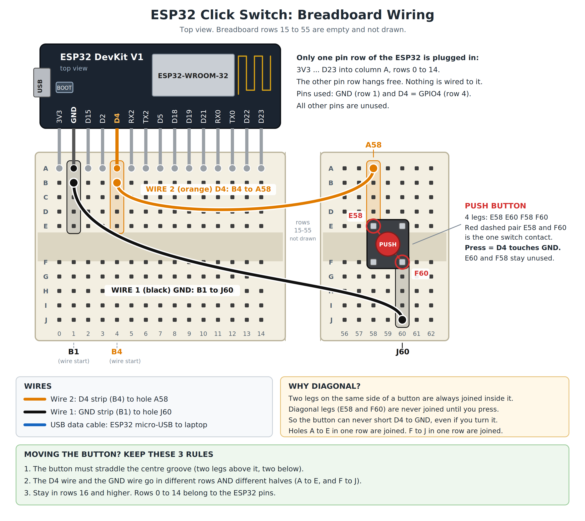

No ESP32? Try the software-only version that uses your webcam: [software-only branch](https://github.com/ARNAV-AHIRRAO/esp32-click-switch/tree/software-only).

# ESP32 Click Switch

Press one small button to switch windows on your Windows laptop. Click once, twice, three times and so on, and each count does a different thing. By default it switches windows (Alt+Tab). You can change every click to open an app, lock the PC, play music and much more, without touching any hardware.



## What it does

| You do | Your laptop does |
|---|---|
| 1 click | Alt+Tab once (jump to the last window) |
| 2 clicks | Alt+Tab twice |
| 3, 4, 5 clicks | Alt+Tab three, four, five times |
| Hold the button for 1.5 seconds | Window switcher opens and stays open. Let go to pick the window |

Want clicks to open apps, lock the PC, control music or slides? See [docs/ACTIONS.md](docs/ACTIONS.md) for ready-to-copy lines.

## What you need

| Part | Quantity |
|---|---|
| ESP32 DevKit V1 board | 1 |
| Breadboard | 1 |
| Push button with 4 legs | 1 |
| Male-to-male jumper wires | 2 |
| Micro-USB **data** cable (not a charge-only cable) | 1 |
| Windows laptop | 1 |

## Step 1. Build the circuit (5 minutes)

Follow the picture above. The full electrical drawing is in [hardware/schematic.png](hardware/schematic.png).

1. Plug the ESP32 into the breadboard.
2. Press the button into the breadboard so it sits across the middle groove, two legs on each side.
3. Connect jumper wire 1 (black): from the strip of the **GND** pin to one leg of the button.
4. Connect jumper wire 2 (orange): from the strip of the **D4** pin to the **diagonally opposite** leg of the button.
5. Plug the USB cable into the ESP32 and the laptop.

Important: the two wires must go to **diagonal** legs of the button. Diagonal legs are never connected inside the button until you press it, so a wrong turn cannot cause a short circuit.

The hole numbers in the picture (B1, B4, A58, J60) are just an example. Your button and wires can go anywhere on the breadboard as long as the three rules in the picture are followed.

## Step 2. Install the software (one time, 15 minutes)

1. **Python:** download from [python.org/downloads](https://www.python.org/downloads/). In the installer, tick **Add python.exe to PATH**, then click **Install Now**.
2. **Arduino IDE:** download from [arduino.cc/en/software](https://www.arduino.cc/en/software) and install it.
3. **ESP32 support inside Arduino IDE:**
   - Open Arduino IDE. Click **File**, then **Preferences**.
   - In **Additional boards manager URLs**, paste: `https://espressif.github.io/arduino-esp32/package_esp32_index.json` and click **OK**.
   - Click **Tools**, then **Board**, then **Boards Manager**. Search `esp32`. Install **esp32 by Espressif Systems**.
4. **Python libraries:** press the Windows key + R, type `cmd`, press Enter. In the terminal, run:

```
pip install -r software/requirements.txt
```
*(Includes `pyserial` and `pynput`, plus optional `pystray` and `pillow` for Windows System Tray support)*

## Step 3. Put the program on the ESP32 (once)

1. On this page click the green **Code** button, then **Download ZIP**. Unzip it.
2. Open Arduino IDE. Click **File**, then **Open**, and pick `firmware/click_switch/click_switch.ino`.
3. Click **Tools**, then **Board**, then **esp32**, then **ESP32 Dev Module**.
4. Click **Tools**, then **Port**, and pick the COM port of your ESP32.
5. Click the **right arrow** button at the top left (Upload). Wait for `Hard resetting via RTS pin`.
   - If it is stuck on `Connecting......`, hold the **BOOT** button on the ESP32 until the upload starts.

The program now lives inside the ESP32. You never need to upload it again.

> [!TIP]
> **Want 100% Wireless without running any Python?** Check out [firmware/ble_switch/ble_switch.ino](firmware/ble_switch/ble_switch.ino) to turn your ESP32 into a native Bluetooth HID keyboard that works on Windows, Mac, iPad, and Android!

## Step 4. Run it

1. Open the `software` folder in File Explorer. Click the address bar, type `cmd`, and press Enter.
2. Type `python switch.py` and press Enter.
3. **Auto-Detection:** The script automatically discovers your ESP32 board! You should see `Connected to ESP32 on COMx`.
4. A mini **System Tray icon** will appear in the Windows notification area with quick controls (Pause, Reload Config, Exit).

## Step 5. Try it

Open a few windows, then click the button:
- **1 to 5 clicks:** Switches windows (`Alt+Tab x1`, `Alt+Tab x2`, etc.).
- **Hold for 1.5 seconds:** Window switcher opens and stays visible. Let go to pick the window.
- **Hold for 4.0 seconds (Panic Lock):** Instantly locks your PC.
- **Onboard LED:** The blue LED on the ESP32 lights up on every press and hold for instant physical feedback!

## Make it yours (No Code Required!)

You do **not** need to touch Python code to customize actions! Open `software/config.json` in Notepad or VS Code:

```json
{
  "actions": {
    "1": { "name": "Alt+Tab x1", "type": "alt_tab", "times": 1 },
    "2": { "name": "Alt+Tab x2", "type": "alt_tab", "times": 2 },
    "3": { "name": "Show Desktop", "type": "hotkey", "keys": ["cmd", "d"] },
    "4": { "name": "Play / Pause", "type": "media", "command": "play_pause" },
    "5": { "name": "Open Chrome", "type": "open", "target": "chrome.exe" },
    "9": { "name": "Lock Workstation", "type": "power", "command": "lock" }
  }
}
```

Save the file, and `switch.py` will **automatically reload** your new configuration without restarting! See [docs/ACTIONS.md](docs/ACTIONS.md) for more examples.

## Start automatically with Windows (optional)

1. Press Windows key + R, type `shell:startup`, press Enter.
2. Right-click in the folder, choose **New**, then **Shortcut**.
3. Paste this as the location, with your real path to `switch.py`: `pythonw.exe "C:\path\to\switch.py"`. Click **Next**, then **Finish**.

It now runs hidden with a System Tray icon at every Windows start. To pause it while gaming or typing, right-click the tray icon and select **Pause Shortcuts**.

## Something wrong?

| Problem | Fix |
|---|---|
| No COM port shows up | You are using a charge-only cable. Use a data cable. Try another USB port |
| Upload stuck on `Connecting......` | Hold the BOOT button on the ESP32 while uploading |
| `could not open port` or `Access is denied` | Another program is using the port. Close Arduino Serial Monitor. Right-click the system tray icon and click Exit |
| `No module named 'serial'` | Type `pip install -r software/requirements.txt` |
| Nothing happens when clicking | The blue LED on the ESP32 should turn on when pressed. If not, check the breadboard wiring |
| `HOLD` appears by itself | The two wires are not on diagonal legs. Move one wire to the diagonal leg |
| Alt key feels stuck | Tap the Alt key once. The program automatically releases Alt on exit |

## More

- [How it works step by step](docs/HOW_IT_WORKS.md) (circuit, timing, firmware, and Python driver)
- [All the things a click can do](docs/ACTIONS.md) (actions and `config.json` recipes)
- [Wireless and future upgrades](docs/UPGRADES.md) (BLE Keyboard, Wi-Fi UDP, and Rotary Encoder)

Works on Windows. For wireless cross-platform use (Mac, Linux, iPad), see the BLE Keyboard mode.
