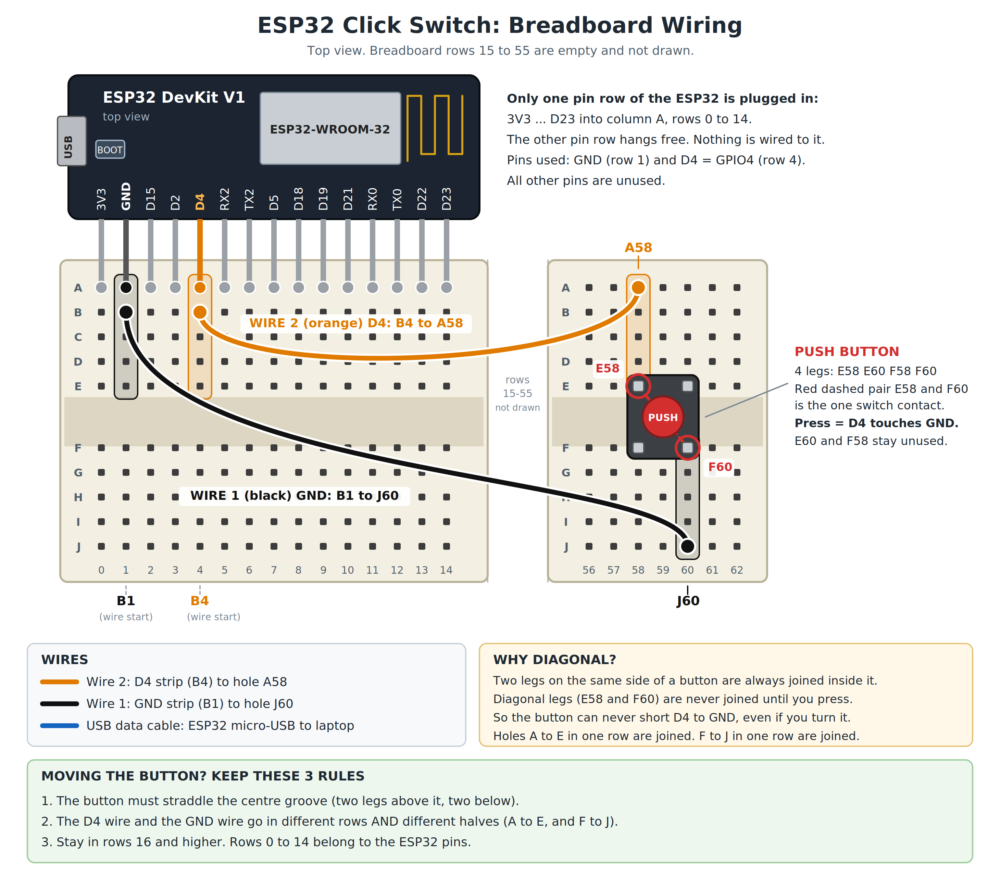

No ESP32? Try the software-only version that uses your webcam: [software-only branch](https://github.com/ARNAV-AHIRRAO/esp32-click-switch/tree/software-only).

# ESP32 Click Switch

Press one small button to switch windows on your Windows laptop. Click once, twice, three times and so on, and each count does a different thing. By default it switches windows (Alt+Tab). You can change every click to open an app, lock the PC, play music and much more, without touching any hardware.



## What it does

| You do | Your laptop does |
|---|---|
| 1 click | Alt+Tab once (jump to the last window) |
| 2 clicks | Alt+Tab twice |
| 3, 4, 5 clicks | Alt+Tab three, four, five times |
| Hold the button for 1.5 seconds | Window switcher opens and stays open. Let go to pick the window |

Want clicks to open apps, lock the PC, control music or slides? See [docs/ACTIONS.md](docs/ACTIONS.md) for ready-to-copy lines.

## What you need

| Part | Quantity |
|---|---|
| ESP32 DevKit V1 board | 1 |
| Breadboard | 1 |
| Push button with 4 legs | 1 |
| Male-to-male jumper wires | 2 |
| Micro-USB **data** cable (not a charge-only cable) | 1 |
| Windows laptop | 1 |

## Step 1. Build the circuit (5 minutes)

Follow the picture above. The full electrical drawing is in [hardware/schematic.png](hardware/schematic.png).

1. Plug the ESP32 into the breadboard.
2. Press the button into the breadboard so it sits across the middle groove, two legs on each side.
3. Connect jumper wire 1 (black): from the strip of the **GND** pin to one leg of the button.
4. Connect jumper wire 2 (orange): from the strip of the **D4** pin to the **diagonally opposite** leg of the button.
5. Plug the USB cable into the ESP32 and the laptop.

Important: the two wires must go to **diagonal** legs of the button. Diagonal legs are never connected inside the button until you press it, so a wrong turn cannot cause a short circuit.

The hole numbers in the picture (B1, B4, A58, J60) are just an example. Your button and wires can go anywhere on the breadboard as long as the three rules in the picture are followed.

## Step 2. Install the software (one time, 15 minutes)

1. **Python:** download from [python.org/downloads](https://www.python.org/downloads/). In the installer, tick **Add python.exe to PATH**, then click **Install Now**.
2. **Arduino IDE:** download from [arduino.cc/en/software](https://www.arduino.cc/en/software) and install it.
3. **ESP32 support inside Arduino IDE:**
   - Open Arduino IDE. Click **File**, then **Preferences**.
   - In **Additional boards manager URLs**, paste: `https://espressif.github.io/arduino-esp32/package_esp32_index.json` and click **OK**.
   - Click **Tools**, then **Board**, then **Boards Manager**. Search `esp32`. Install **esp32 by Espressif Systems**.
4. **Two Python libraries:** press the Windows key + R, type `cmd`, press Enter. In the black window type this and press Enter:

```
pip install pyserial pynput
```

## Step 3. Put the program on the ESP32 (once)

1. On this page click the green **Code** button, then **Download ZIP**. Unzip it.
2. Open Arduino IDE. Click **File**, then **Open**, and pick `firmware/click_switch/click_switch.ino`.
3. Click **Tools**, then **Board**, then **esp32**, then **ESP32 Dev Module**.
4. Click **Tools**, then **Port**, and pick the COM port that appears when the ESP32 is plugged in. Write the number down (for example COM3).
5. Click the **right arrow** button at the top left (Upload). Wait for the message `Hard resetting via RTS pin`.
   - If it is stuck on `Connecting......`, hold the **BOOT** button on the ESP32 until the upload starts.

The program now lives inside the ESP32. You never need to upload it again.

## Step 4. Run it

1. Find your port number: press Windows key + X, open **Device Manager**, open **Ports (COM & LPT)**. Look for the number of your ESP32.
2. Not COM3? Open `software/switch.py` in Notepad. Find the line `ser = serial.Serial('COM3', 115200)` and change `COM3` to your number. Save.
3. Open the `software` folder in File Explorer. Click the address bar, type `cmd`, press Enter.
4. Type `python switch.py` and press Enter.
5. You should see `Connected COM3`. Leave this window open.

## Step 5. Try it

Open a few windows, then click the button. The black window prints what it understood, for example `2 clicks -> Alt+Tab x2`.

## Make it yours

Open `software/switch.py` and find the block called `ACTIONS`. Each line says: number of clicks, a name, and what to do. Replace a line with one from [docs/ACTIONS.md](docs/ACTIONS.md), save, and run the program again. For example:

```python
1: ("Open Chrome", lambda: open_app(r"C:\Program Files\Google\Chrome\Application\chrome.exe")),
2: ("Lock PC", lambda: ctypes.windll.user32.LockWorkStation()),
```

## Start automatically with Windows (optional)

1. Press Windows key + R, type `shell:startup`, press Enter.
2. Right-click in the folder, choose **New**, then **Shortcut**.
3. Paste this as the location, with your real path to `switch.py`: `pythonw.exe "C:\path\to\switch.py"`. Click **Next**, then **Finish**.

It now runs hidden at every start. To stop it: Task Manager, find `pythonw.exe`, **End task**. Stop it before uploading new code to the ESP32, because it holds the USB port.

## Something wrong?

| Problem | Fix |
|---|---|
| No COM port shows up | You are using a charge-only cable. Use a data cable. Try another USB port |
| Upload stuck on `Connecting......` | Hold the BOOT button on the ESP32 while uploading |
| `could not open port` or `Access is denied` | Another program is using the port. Close Arduino Serial Monitor and any other Python window. End `pythonw.exe` in Task Manager |
| `No module named 'serial'` | Type `pip install pyserial` (not `serial`) |
| Nothing happens when clicking | Close the black window. In Arduino IDE open **Tools**, **Serial Monitor**, set **115200** at the bottom right, and click the button. Numbers should appear. If not, check the wiring |
| `HOLD` appears by itself | The two wires are not on diagonal legs. Move one wire to the diagonal leg |
| Alt key feels stuck | Tap the Alt key once. Then close and restart the program |
| `Ctrl+C` does not stop the program | Click the button once, then it stops |

## More

- [How it works step by step](docs/HOW_IT_WORKS.md) (from upload to key press)
- [All the things a click can do](docs/ACTIONS.md)
- [Wireless and future upgrades](docs/UPGRADES.md)

Works on Windows only (the app-opening and power functions are Windows functions).
